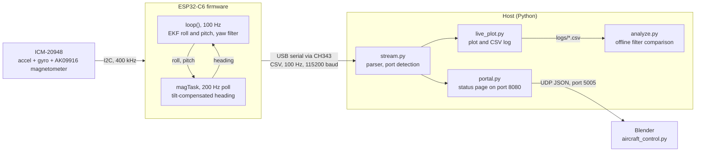
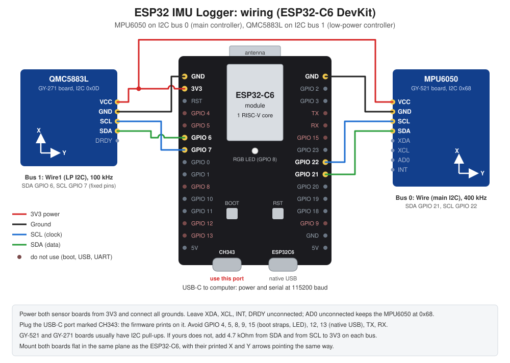
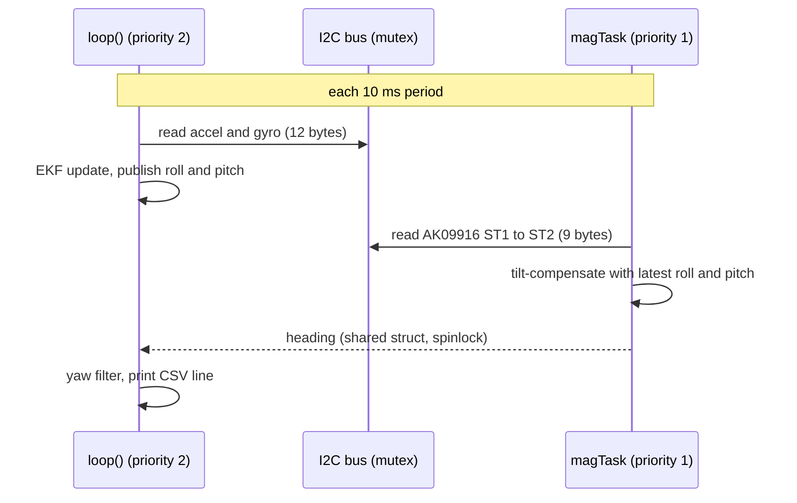
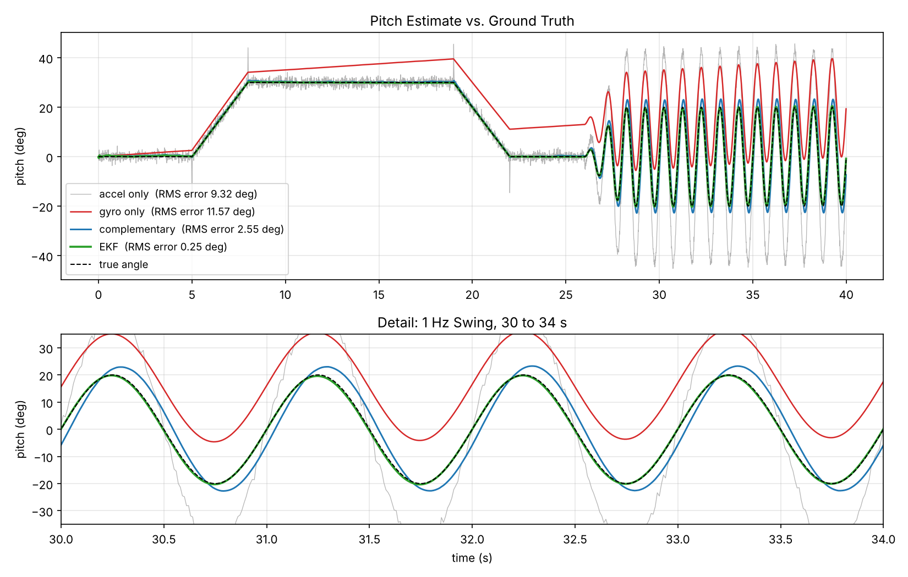

# ESP32 IMU Logger: 9-Axis Attitude and Heading Estimation on the ESP32-C6


**Technical report.** Author: Shyam Iyer. License: MIT.

## Abstract

This project estimates the full orientation of a hand-held board (roll, pitch and heading) in real time and uses it to fly a 3D aircraft in Blender. An ESP32-C6 microcontroller reads a TDK InvenSense ICM-20948 9-axis IMU (accelerometer, gyroscope and AK09916 magnetometer) over I2C with register-level drivers and no sensor libraries. Roll and pitch come from an extended Kalman filter (EKF) that also learns the residual gyro bias. Heading comes from a tilt-compensated magnetometer reading fused with the gyro's yaw rate. The firmware runs as two FreeRTOS tasks sharing one I2C bus and streams CSV at 100 Hz over USB. A Python host plots and logs the stream, scores the filters offline, and forwards orientation to Blender over UDP. On a simulated benchmark with known ground truth the EKF's RMS tilt error is 0.25°, against 2.55° for a complementary filter and 9.3° for the accelerometer alone. The firmware also builds for the original dual-core ESP32 and for the Wokwi simulator.

## Contents

1. [Introduction](#1-introduction)
2. [System Overview](#2-system-overview)
3. [Hardware](#3-hardware)
4. [Firmware](#4-firmware)
5. [Host Software](#5-host-software)
6. [3D Visualization in Blender](#6-3d-visualization-in-blender)
7. [Verification](#7-verification)
8. [Limitations and Future Work](#8-limitations-and-future-work)
- [Appendix A: Setup Guide](#appendix-a-setup-guide)
- [Appendix B: Building, Flashing and Simulating](#appendix-b-building-flashing-and-simulating)
- [Appendix C: Serial Protocol](#appendix-c-serial-protocol)
- [Appendix D: Configuration Constants](#appendix-d-configuration-constants)
- [Appendix E: Project Structure](#appendix-e-project-structure)

## 1. Introduction

Motion-based control replaces a joystick with the orientation of an object the user holds. It is the core of human-machine interfaces such as prosthetic control, rehabilitation tracking and gesture input. Orientation cannot be measured by any one inertial sensor alone:

- A **gyroscope** measures angular rate. Integrating it gives smooth angles that drift without bound, because any bias integrates into a growing error.
- An **accelerometer** measures gravity and so gives absolute roll and pitch, but it is noisy and cannot tell gravity from the acceleration of a moving hand.
- A **magnetometer** measures the Earth's field and so gives absolute heading, but only when the reading is corrected for tilt, and it is disturbed by nearby metal.

Sensor fusion combines them so each covers the others' weaknesses.

**Objectives**

1. Estimate roll, pitch and heading at 100 Hz on a low-cost microcontroller, with bounded drift.
2. Quantify the gain from an EKF over a complementary filter against known ground truth.
3. Stream the estimate to a host for plotting, logging and offline analysis.
4. Drive a 3D model in real time from the estimate.
5. Keep the code verifiable: shared filter code between firmware and host tests, and CI on every push.

## 2. System Overview



| Stage | Component | Role |
|---|---|---|
| Sensing | ICM-20948 | Accelerometer and gyroscope at 225 Hz output rate; AK09916 magnetometer at 100 Hz |
| Estimation | ESP32-C6 firmware (`src/main.cpp`, `include/imu_filter.h`) | Calibration, EKF tilt, tilt-compensated heading, yaw fusion, CSV output |
| Transport | USB serial (CH343 chip) | 10 CSV columns per sample at 100 Hz |
| Host | `host/` (Python) | Port detection, parsing, live plot, logging, offline analysis, UDP bridge |
| Visualization | `blender/aircraft_control.py` | Procedural jet whose attitude and position follow the board |

## 3. Hardware

### 3.1 Bill of Materials

| Part | Notes |
|---|---|
| ESP32-C6 DevKit with CH343 USB serial | The board this report targets: one RISC-V core, two USB-C ports (CH343 and native USB). An original ESP32 DevKit also works (Appendix B). |
| ICM-20948 breakout board | Any 3.3 V I2C breakout (for example Adafruit 4554 or SparkFun 15335). The AK09916 magnetometer is inside the same package. |
| 4 jumper wires, or a Qwiic / STEMMA QT cable | 3V3, GND, SDA, SCL |
| USB-C data cable | Some cables only charge |

### 3.2 Wiring



| ICM-20948 board | ESP32-C6 DevKit | Original ESP32 DevKit |
|---|---|---|
| VCC (or VIN / 3.3V) | 3V3 | 3V3 |
| GND | GND | GND |
| SDA | GPIO 21 | GPIO 21 |
| SCL | GPIO 22 | GPIO 22 |
| AD0, INT, FSYNC | not connected | not connected |

The pin order on ICM-20948 boards differs between makers, so match the printed labels. Boards with a Qwiic or STEMMA QT connector can use a cable that ends in jumper wires. Most breakout boards already have I2C pull-up resistors. If yours does not, add 4.7 kΩ from SDA to 3V3 and from SCL to 3V3. The diagram is generated by `tools/wiring_diagram.py`.

**USB.** Plug in the USB-C port marked **CH343**. The firmware prints on UART0, which the CH343 chip bridges to USB. The other port, marked ESP32C6, is the chip's native USB.

### 3.3 Pin Selection on the ESP32-C6

| Pins | Why they are avoided or used |
|---|---|
| GPIO 21, 22 | Used for I2C: plain GPIOs with no boot or USB function. The same numbers exist on the original ESP32 DevKit, so the wiring is identical on both boards. |
| GPIO 4, 5, 8, 9, 15 | Boot strapping pins: their level at reset selects the boot mode. GPIO 9 is the BOOT button and GPIO 8 drives the RGB LED. |
| GPIO 12, 13 | Native USB D− and D+ |
| TX, RX (GPIO 16, 17) | UART0 link to the CH343, used for the CSV stream |

### 3.4 Sensor Frame and Mounting

The accelerometer and gyroscope use a right-handed frame: **+x forward, +y left, +z up** out of the chip's top face. The AK09916 magnetometer die inside the package is mounted with its y and z axes reversed (+x forward, +y right, +z down), and the firmware converts it into the accelerometer's frame (Section 4.5). Mount the board flat, in the same plane as the ESP32-C6, and keep it away from motors, batteries, steel and magnets, all of which bend the local magnetic field.

## 4. Firmware

### 4.1 Task Architecture

The ESP32-C6 has one high-performance core, so the firmware is split into two FreeRTOS tasks that interleave on it:

| Task | Priority | Rate | Work |
|---|---|---|---|
| `loop()` (Arduino loopTask) | 2 | 100 Hz | Read accelerometer and gyro, run the EKF, fuse yaw, print one CSV line. The only task that writes to Serial. |
| `magTask` | 1 | polls at 200 Hz | Read each new 100 Hz AK09916 sample, tilt-compensate it with the latest roll and pitch, publish a heading |



- **Timing.** Both tasks wake with `vTaskDelayUntil`, which sleeps until absolute multiples of the period. The rate does not depend on execution time, and the tick is 1 kHz, so the 10 ms period is exact. The tasks sleep between samples. On a single core a busy-wait would starve the other task and the idle task.
- **Priority.** `loop()` runs at priority 2, so IMU sampling preempts the magnetometer task and keeps its timing.
- **Bus sharing.** The ICM-20948 and its AK09916 share one I2C bus, so each transaction takes a FreeRTOS mutex. The mutex uses priority inheritance: if the magnetometer task holds the bus when `loop()` wakes, it is raised to finish its transfer, about 0.3 ms, at once.
- **Shared data.** The tasks exchange only roll, pitch and the latest heading, through a small struct guarded by a spinlock (`portENTER_CRITICAL`). A sequence number marks each new heading, so `loop()` only uses a heading that is new since the last sample.
- **On the dual-core ESP32** the same code puts `magTask` on core 0 and `loop()` on core 1, so the two tasks compute in parallel and only the bus transfers are serialized.

### 4.2 ICM-20948 Configuration

Register level, with the register map checked against the ICM-20948 datasheet values used by SparkFun's driver and PX4. Registers are split into four banks selected by `REG_BANK_SEL` (0x7F, bank number in bits 5:4).

| Step | Register | Value | Effect |
|---|---|---|---|
| Probe | WHO_AM_I (bank 0, 0x00) | expect 0xEA | Tried at 0x69 (AD0 high, most boards), then 0x68 |
| Reset | PWR_MGMT_1 (0x06) | 0x80, wait 100 ms | All registers to defaults |
| Wake | PWR_MGMT_1 | 0x01 | Out of sleep, best available clock (gyro PLL) |
| Enable axes | PWR_MGMT_2 (0x07) | 0x00 | All accelerometer and gyro axes on |
| Aux bus | USER_CTRL (0x03) | 0x00 | Internal I2C master off |
| Bypass | INT_PIN_CFG (0x0F) | 0x02 | AK09916 appears directly on the host bus at 0x0C |
| Gyro rate | GYRO_SMPLRT_DIV (bank 2, 0x00) | 4 | 1125 / (1 + 4) = 225 Hz output |
| Gyro range and filter | GYRO_CONFIG_1 (bank 2, 0x01) | 0x19 | ±250 °/s (131 LSB per °/s), low-pass about 50 Hz |
| Accel rate | ACCEL_SMPLRT_DIV_1, _2 (bank 2, 0x10, 0x11) | 0, 4 | 225 Hz output |
| Accel range and filter | ACCEL_CONFIG (bank 2, 0x14) | 0x19 | ±2 g (16384 LSB per g), low-pass about 50 Hz |
| Magnetometer | AK09916 WIA2 (0x01), CNTL3 (0x32), CNTL2 (0x31) | expect 0x09; 0x01; 0x08 | Check ID, soft reset, continuous mode at 100 Hz |

The output rate (225 Hz) is above twice the 100 Hz sampling rate, and the low-pass filter removes content above about 50 Hz, so sampling at 100 Hz does not alias. Each sample is one 12-byte burst read from ACCEL_XOUT_H (0x2D), so all six axes come from the same instant. Each magnetometer read is one 9-byte burst from ST1 (0x10) to ST2 (0x18). ST1 says whether a new sample is ready, ST2 flags magnetic overflow, and reading ST2 tells the chip the sample has been taken.

### 4.3 Startup and Calibration

1. **Gyro bias, 2 s, board still.** The mean of 200 samples is the bias, subtracted from every later reading. Any bias left over is learned by the EKF (Section 4.4).
2. **Magnetometer hard-iron offset, 15 s, rotate the board in every direction.** Fixed magnetic fields carried with the board (magnets, magnetized parts) shift every reading by a constant. The firmware records the minimum and maximum on each axis and takes the midpoint as the offset. The board must be turned through all orientations for the range to be complete.
3. The task starts and CSV output begins. The header line and all status messages start with `#`.

### 4.4 Attitude Estimation (Roll and Pitch)

Two filters share the same interface in `include/imu_filter.h`. `FUSION_EKF` selects one at compile time, and the CSV format is the same either way.

**Complementary filter (baseline)**

```
angle = α · (angle + gyro_rate · dt) + (1 − α) · accel_angle,     α = τ / (τ + dt)
```

τ = 0.5 s and dt = 10 ms give α = 0.980. Content faster than τ comes from the gyro and slower content from the accelerometer. A constant gyro bias b leaves a bounded steady error of τ·b, compared with unbounded drift for pure integration.

**Extended Kalman filter (default)**

State `x = [roll, pitch, b_x, b_y]`: the two angles plus the gyro bias on each tilt axis.

- **Predict:** full Euler-angle kinematics driven by the bias-corrected gyro, `roll' = p + sin(roll)·tan(pitch)·q + cos(roll)·tan(pitch)·r` and `pitch' = cos(roll)·q − sin(roll)·r`, linearized analytically for the covariance update.
- **Update:** the accelerometer measures gravity in the body frame, `h(x) = [−sin(pitch), sin(roll)·cos(pitch), cos(roll)·cos(pitch)]`.
- **Adaptive measurement noise:** `R = σ²_a + k·(|a| − 1 g)²`, so the filter trusts the accelerometer less while the board is accelerating. This removes the complementary filter's lag and overshoot during fast motion.
- **Parameters:** gyro noise 0.3 °/s, bias random walk 0.01 °/s, accelerometer noise 0.05 g, dynamic gain k = 10.

Compared with the complementary filter, the EKF estimates the residual bias (0.52 °/s learned against 0.50 °/s true) instead of leaving a τ·b offset, makes no small-angle approximation, and rejects linear acceleration instead of passing it through. The same filter exists in single-precision C++ for the ESP32 and in NumPy (`host/imu_math.py`); both give 0.25° RMS on the benchmark.

### 4.5 Heading Estimation (Yaw)

**Axis mapping.** The AK09916 reading is converted into the accelerometer's frame by reversing y and z, `m = (m_x, −m_y, −m_z)` (`imu::ak09916ToImuFrame`), and the hard-iron offset is removed.

**Tilt compensation.** A magnetometer gives heading only when level. With roll φ and pitch θ from the attitude filter, the field is projected onto the horizontal plane:

```
x_h = m_x·cos θ + m_y·sin φ·sin θ + m_z·cos φ·sin θ
y_h = m_y·cos φ − m_z·sin φ
ψ_mag = atan2(−y_h, x_h)
```

**Fusion with the gyro.** The magnetometer heading is absolute but noisy and disturbed by nearby metal; the integrated gyro z rate is smooth but drifts. A complementary yaw filter combines them, with every angle difference wrapped the short way round so that crossing ±180° does not spin the estimate:

```
yaw ← wrap(yaw + g_z·dt)                          every sample
yaw ← wrap(yaw + (1 − α)·wrap(ψ_mag − yaw))       when a new heading has arrived
α = τ / (τ + dt),  τ = 10 s
```

The long time constant means a brief magnetic disturbance moves the heading little, while drift stays bounded. Until the first magnetometer sample, yaw is reported as `nan`.

**Convention.** Yaw follows the right-hand rule about +z (up). It is 0 when the board's +x axis points at magnetic north and increases as the board turns **counterclockwise** seen from above. `HEADING_SIGN = -1` gives a clockwise compass heading instead. No magnetic declination is applied, so the reference is magnetic, not true, north.

### 4.6 Output and Resource Use

Each sample is one CSV line (Appendix C). Build sizes with the EKF:

| Target | Flash | RAM |
|---|---|---|
| ESP32-C6 (`esp32c6`) | 24.8% | 4.7% |
| Original ESP32 (`esp32dev`) | 26.4% | 7.2% |
| Wokwi simulation (`wokwi`) | 26.2% | 7.2% |

## 5. Host Software

All host code is Python 3.9 or newer, in `host/`.

| Module | Purpose |
|---|---|
| `stream.py` | Serial, Wokwi (RFC2217) and synthetic sources; CSV parser; serial port auto-detection |
| `live_plot.py` | Real-time plot of accelerometer, gyro and fused angles; writes each session to `logs/` |
| `analyze.py` | Plots recorded logs, regenerates the benchmark figure, and reruns both filters offline on a real log |
| `imu_math.py` | NumPy versions of both filters and the synthetic IMU generator |
| `portal.py` | Bridge to Blender over UDP, with a live status page |

**Parsing.** Comment lines (`#`) and lines corrupted in transit are skipped. Logs recorded before the magnetometer was added have 9 columns and still load, with yaw filled as `nan`.

**Port detection.** The host recognizes common USB-serial chips (CP210x, CH340, CH343, CH9102, FTDI) on Windows, macOS and Linux. On the ESP32-C6 DevKit both USB ports may be connected; the CH343 port is preferred over the chip's native USB JTAG port, since the firmware prints on the CH343.

**Portal.** `python -m host.portal --port auto` reads the stream and sends each sample as one UDP packet to 127.0.0.1:5005, for example `{"roll": 12.3, "pitch": -4.5, "yaw": 87.0, "t_ms": 12345}`. `yaw` is left out until the firmware reports a heading. A status page at http://127.0.0.1:8080 shows live roll, pitch and heading. `--demo` uses simulated data and `--reset` sends `{"reset": true}`.

## 6. 3D Visualization in Blender

`blender/aircraft_control.py` runs in Blender's Text Editor. If no object named `Aircraft` exists, it builds a jet from primitives (fuselage, nose cone, wings, tailplane, fin, nozzle, canopy) parented to one empty, so no third-party model or licence is involved.

About 60 times a second the script reads the newest packet, smooths it (`SMOOTHING`), and:

- **Sets attitude** as `R = Rz(yaw) · Rx(pitch) · Ry(roll)`: roll and pitch about the jet's own axes, then heading about the world vertical. Composing matrices avoids the axis-order errors of Euler angles. Yaw smoothing is wrap-aware.
- **Moves the jet:** tilt past a 3° deadband slides it sideways (roll) or climbs and descends it (pitch), at 0.6 m/s per degree past the deadband, within fixed limits. A level board holds position.

`ROLL_SIGN`, `PITCH_SIGN` and `YAW_SIGN` flip directions to suit how the board is held.

**Running it:** open `blender/aircraft_control.py` in Blender's Text Editor and press Run Script; start `python -m host.portal --port auto` (or `--demo`); optionally open http://127.0.0.1:8080.

## 7. Verification

### 7.1 Simulation Benchmark



Synthetic data with known ground truth: sensor 30 cm from a pivot; stationary, a 30° tilt and return, then a 1 Hz ±20° swing. The gyro has 0.5 °/s residual bias plus white noise. The accelerometer has white noise plus tangential acceleration during the swing.

| Estimate | RMS Error (deg) |
|---|---|
| Gyro only (integrated rate) | 11.6 |
| Accelerometer only (gravity angle) | 9.3 |
| Complementary filter | 2.55 |
| **Extended Kalman filter** | **0.25** |

Regenerate with `python -m host.analyze --simulate`.

### 7.2 Real-Hardware Test Procedure

1. Record a session (menu option 2, or `python -m host.live_plot --port auto`). Keep the board still for the 2 s calibration, then rotate it in every direction for the 15 s magnetometer calibration.
2. Hold the board still at known pitch angles, in order, for 3 s or more each (for example 0°, 30°, 45°, 60° on a 3D-printed wedge or against a protractor), moving smoothly between holds.
3. Run `python -m host.analyze --compare logs/imu_YYYYMMDD_HHMMSS.csv --holds 0,30,45,60`.

Both filters are rerun offline from the logged raw accelerometer and gyro columns. Each still segment is matched to the next hold angle, and the per-hold error and RMS for each filter are printed and plotted to a `_compare.png` next to the log.

**Heading check.** Lay the board flat with +x toward magnetic north (from a phone compass): `yaw_deg` should read near 0. Turn it 90° counterclockwise seen from above: it should read near +90.

### 7.3 Automated Tests

| Suite | What it checks |
|---|---|
| Python (pytest, `tests/`) | CSV parsing (10 columns, 9-column legacy logs, `nan` yaw, corrupt lines); port detection on Windows, macOS and Linux, including CH343 over native USB; accelerometer angles; the τ·b bias bound; fused error below half of the best single sensor; EKF error below a quarter of the complementary filter's; EKF bias learning at 0, 0.5 and 2 °/s; combined roll and pitch; still-segment detection and hold scoring; portal packets and state; Blender stick mapping, packet parsing, attitude matrix, jet construction, and flight and yaw from live UDP packets (these need `bpy` and are skipped without it) |
| Firmware math (C++, `tests/firmware/`) | Compiled from the same `imu_filter.h` the ESP32 uses: big-endian byte assembly, complementary filter, EKF initialization, bias learning and rotation tracking, angle wrapping, heading on level and tilted boards, heading sign, AK09916 axis mapping, and the yaw filter (initialization, tracking, bias bound, gyro-only drift, ±180° crossing) |
| Firmware build (PlatformIO) | Compiles all three targets: `esp32c6`, `esp32dev`, `wokwi` |

### 7.4 Continuous Integration

GitHub Actions runs on every push and pull request: the Python tests on Ubuntu 24.04, macOS and Windows with Python 3.9 and 3.13 (through the beginner launcher `start.py`); the C++ firmware math tests on Ubuntu and macOS; and the PlatformIO build of every target. The Ubuntu runner is pinned to 24.04 because Python 3.9 is not available for setup on newer Ubuntu images.

## 8. Limitations and Future Work

**Limitations**

- **Hardware validation.** The ICM-20948 firmware has been compiled for all targets and its math unit-tested, but it has not yet been run on a physical board. The register sequence follows the datasheet values used by SparkFun's driver and PX4.
- **Euler-angle singularity.** The EKF's kinematics contain tan(pitch), so accuracy degrades near ±90° pitch (gimbal lock).
- **Magnetometer calibration** corrects hard-iron offsets only. Soft-iron distortion (field bending by nearby metal) is not corrected, and no declination is applied.
- **Yaw-axis gyro bias.** The EKF learns bias on x and y only. A residual z bias b_z leaves a steady heading offset of about τ·b_z (10 s × b_z).
- **Simulation.** Wokwi has no ICM-20948, so the simulated build uses an MPU6050 and has no heading.

**Future work**

1. A single 9-axis estimator: a quaternion (multiplicative) EKF with the magnetometer as a measurement, estimating all three gyro biases. This removes the gimbal lock and the separate yaw filter.
2. Ellipsoid fitting for soft-iron magnetometer calibration, stored in flash so the 15 s rotation is needed only once.
3. Hardware validation against a reference (a motion-capture system or a rotary stage) and a heading accuracy figure.
4. Wireless streaming over the ESP32-C6's Wi-Fi or Bluetooth LE, removing the USB cable for hand-held use.

## Appendix A: Setup Guide

For Mac or Windows, no experience needed.

You do not need to know Python. Each step says exactly what to click or type; copying and pasting is fine.

**1. Install Python (once per computer)**

- **Mac:** open Terminal (press Cmd+Space, type `Terminal`, press Return). Type `python3 --version` and press Return.
  - If it shows Python 3.9 or newer, go to step 2.
  - If a box offers to install the "command line developer tools", click **Install**, wait for it to finish, and check again.
  - Otherwise download the macOS installer from https://www.python.org/downloads/, open it, and click through.
- **Windows:** download the installer from https://www.python.org/downloads/ and open it. On the first screen tick **Add python.exe to PATH**, then click **Install Now**.

**2. Download this project**

Click the green **Code** button at the top of this page, then **Download ZIP**. Unzip it: on a Mac double-click the ZIP in Downloads; on Windows right-click it, choose **Extract All**, then **Extract**. You now have a folder named `ESP32-IMU-Logger-main`.

**3. Start it**

- **Windows:** open the `ESP32-IMU-Logger-main` folder and double-click **start.bat**.
- **Mac:** in Terminal type `cd ` (with a space after it), drag the `ESP32-IMU-Logger-main` folder from Finder into the Terminal window, and press Return. Then type `python3 start.py` and press Return.

The first time, it sets itself up: it creates a private Python environment inside the project folder and downloads the libraries it needs. This takes a few minutes and needs internet. Then a menu appears. Type a number and press Enter:

| Option | What it does | What you get |
| --- | --- | --- |
| 1 | Live plot with simulated data | No hardware needed. Shows accelerometer, gyro and fused tilt scrolling live and saves a log in `logs/`. Close the plot window to stop |
| 2 | Live plot from a real ESP32 | With the board plugged in by USB and running the firmware (see Appendix B). Finds the port automatically |
| 3 | Live plot from the Wokwi simulator | With the simulator running in VS Code (see Appendix B) |
| 4 | List the serial ports | Shows every serial port and which one looks like the ESP32 |
| 5 | Plot a recorded log | Plots a CSV from `logs/` (the newest by default) |
| 6 | Regenerate the filter comparison figure | Rebuilds `figures/filter_comparison.png` and opens it |
| 7 | Run the automated tests | Checks parsing, the filter math and port detection |

To use it again later, repeat step 3; setup is skipped and the menu appears in a few seconds. Type `q` and press Enter to quit.

**Troubleshooting (computer and Python)**

| Problem | Fix |
| --- | --- |
| Mac: `command not found: python3` | Install Python (step 1). |
| Windows: `Python was not found`, or the Microsoft Store opens | Install Python from python.org (step 1) and tick **Add python.exe to PATH**. If you already installed it without that box, run the installer again, choose **Modify**, then **Next**, and tick **Add Python to environment variables**. |
| Windows: "Windows protected your PC" when opening start.bat | Click **More info**, then **Run anyway**. The file only runs `py start.py`; you can open it in Notepad to check. |
| `This project needs Python 3.9 or newer` | Install the current Python from https://www.python.org/downloads/ |
| `Could not tell which port is the ESP32` | Use a USB **data** cable (some only charge). Install the USB driver for the chip printed next to the board's USB port: CP2102 or CP2104 uses the [Silicon Labs CP210x driver](https://www.silabs.com/developers/usb-to-uart-bridge-vcp-drivers); CH340 or CH9102 uses the CH340 driver ([install guide](https://learn.sparkfun.com/tutorials/how-to-install-ch340-drivers/all)). On a Mac, allow the driver under System Settings, Privacy and Security. Then pick option 4 to check. |
| `Could not open` the port | Another program is using it. Close the Arduino IDE or PlatformIO serial monitor and try again. |
| The plot window is blank | No data is arriving: check that the firmware is running and finished its 2 s calibration, and that the baud rate is 115200. |
| `Installing libraries failed` or setup stops with an error | Check your internet connection, delete the `.venv` folder inside the project folder, and start again. (On a Mac the folder is hidden: press Cmd+Shift+. in Finder to show it.) |
| A figure did not open by itself | Look in the project's `figures` folder. |

**For developers.** `start.py` only creates `.venv`, installs `requirements.txt` and runs the commands below, so you can also work by hand (Python 3.9 or newer):

```bash
# macOS / Linux
python3 -m venv .venv
source .venv/bin/activate
pip install -r requirements.txt
```

```powershell
# Windows (PowerShell or Command Prompt)
py -m venv .venv
.venv\Scripts\activate       # if PowerShell blocks this: Set-ExecutionPolicy -Scope CurrentUser RemoteSigned
pip install -r requirements.txt
```

```bash
python -m host.live_plot --demo              # simulated data
python -m host.live_plot --port auto         # real board (or --port COM3, --port /dev/cu.usbserial-0001)
python -m host.live_plot --list-ports
python -m pytest
```

`python start.py <shortcut>` runs one menu option directly (`python start.py --list` shows the shortcuts). CI runs the tests through `start.py` on macOS, Windows and Linux with Python 3.9 and 3.13.

## Appendix B: Building, Flashing and Simulating

The menu options in Appendix A need only Python. Running the firmware itself needs VS Code with the PlatformIO IDE extension, or a browser (Wokwi).

**Build targets** (`platformio.ini`; `pio run` builds all three):

| Target | Board | IMU | Command |
|---|---|---|---|
| `esp32c6` | ESP32-C6 DevKit | ICM-20948 | `pio run -e esp32c6 -t upload` |
| `esp32dev` | Original ESP32 DevKit | ICM-20948 | `pio run -e esp32dev -t upload` |
| `wokwi` | Simulated original ESP32 | MPU6050 (no magnetometer) | `pio run -e wokwi` |

**Real board.** Wire it as in Section 3.2, connect the CH343 USB-C port, run the upload command, then menu option 2 (or `python -m host.live_plot --port auto`). Port names look like `COM3` on Windows, `/dev/cu.usbserial-0001`, `/dev/cu.wchusbserial...` or `/dev/cu.usbmodem...` on macOS (use the `cu.` one), and `/dev/ttyUSB0` or `/dev/ttyACM0` on Linux. If the upload does not start, hold BOOT, tap RST, release BOOT, and upload again.

**Status messages at startup**

| Message | Meaning and fix |
|---|---|
| `# ICM-20948 found at I2C address 0x69` | Normal (0x68 if AD0 is tied low) |
| `# ERROR: ICM-20948 not found on I2C (SDA GPIO 21, SCL GPIO 22)` | Check VCC, GND, SDA and SCL, and that SDA and SCL are not swapped |
| `# gyro bias (deg/s): ...` | Normal; keep the board still until it appears |
| `# magnetometer: rotate the board slowly in every direction for 15 s` | Start rotating now |
| `# mag offset (counts): ... from N samples` | Normal; N should be about 1500 |
| `# WARN: AK09916 magnetometer not found (bypass mode)` | Yaw will be `nan`. Usually a board that is not a genuine ICM-20948 |
| `# WARN: N magnetometer read failures in the last second` | Bus errors, or a magnet near the sensor overflowing its range |

**Wokwi in the browser**

1. Create a new ESP32 project at wokwi.com.
2. Replace `sketch.ino` with `src/main.cpp`, and add `#define IMU_MPU6050` as its first line (the browser cannot pass build flags).
3. Add a file named `imu_filter.h` containing `include/imu_filter.h`.
4. Replace `diagram.json` with the one in this repository (an MPU6050 on GPIO 21 and 22).
5. Start the simulation. CSV lines begin after the 2 s gyro calibration. Move the MPU6050 sliders to change the inputs. Yaw is `nan`, since the simulated sensor has no magnetometer.

**Wokwi in VS Code, with the live plot**

1. Install the PlatformIO IDE and Wokwi Simulator extensions, and request a free Wokwi license from the command palette.
2. `pio run -e wokwi`
3. Run "Wokwi: Start Simulator" and keep the simulator tab visible.
4. Menu option 3 (or `python -m host.live_plot --port rfc2217://localhost:4000`). `wokwi.toml` exposes the simulated UART as an RFC2217 server on port 4000, which PySerial opens like a physical port.

**Synthetic demo.** Menu option 1 (or `python -m host.live_plot --demo`) runs the same parser, plotter and logger on simulated data, with no board.

## Appendix C: Serial Protocol

115200 baud, 8N1. Lines beginning with `#` are status messages. Each sample, at 100 Hz:

```
t_ms,ax_g,ay_g,az_g,gx_dps,gy_dps,gz_dps,roll_deg,pitch_deg,yaw_deg
```

| Column | Unit | Description |
|---|---|---|
| `t_ms` | ms | Time since boot |
| `ax_g`, `ay_g`, `az_g` | g | Accelerometer |
| `gx_dps`, `gy_dps`, `gz_dps` | °/s | Gyroscope, startup bias removed |
| `roll_deg`, `pitch_deg` | ° | Attitude filter output |
| `yaw_deg` | ° | Fused heading in [−180, 180); `nan` until the first magnetometer sample, or always on the `wokwi` target |

## Appendix D: Configuration Constants

At the top of `src/main.cpp`:

| Constant | Default | Meaning |
|---|---|---|
| `SDA_PIN`, `SCL_PIN` | 21, 22 | I2C pins |
| `I2C_HZ` | 400000 | I2C clock |
| `SAMPLE_HZ` | 100 | Accelerometer, gyro and CSV rate |
| `MAG_TASK_HZ` | 200 | Magnetometer polling rate (sensor outputs 100 Hz) |
| `FUSION_EKF` | 1 | 1: EKF, 0: complementary filter |
| `FILTER_TAU_S` | 0.5 | Complementary filter time constant (s) |
| `YAW_TAU_S` | 10 | Yaw filter time constant (s) |
| `HEADING_SIGN` | 1 | 1: counterclockwise-positive yaw; −1: clockwise compass heading |
| `CALIBRATION_SAMPLES` | 200 | Gyro calibration length (2 s) |
| `MAG_CAL_SAMPLES` | 1500 | Magnetometer calibration length (15 s) |

At the top of `blender/aircraft_control.py`: `ROLL_SIGN`, `PITCH_SIGN`, `YAW_SIGN`, `SMOOTHING`, `DEADBAND_DEG`, `SPEED_PER_DEG`, `UDP_PORT`.

## Appendix E: Project Structure

```
start.py, start.bat         beginner launcher: sets up .venv and shows the menu
src/main.cpp                ESP32 firmware (ICM-20948 driver, tasks, CSV output)
include/imu_filter.h        filter math shared by the firmware and the C++ tests
platformio.ini              build targets: esp32c6, esp32dev, wokwi
diagram.json, wokwi.toml    Wokwi circuit (MPU6050) and simulator config
figures/                    wiring diagram and filter comparison figure
tools/wiring_diagram.py     generates figures/wiring_diagram.svg
host/
  stream.py                 serial, Wokwi and synthetic sources; CSV parser; port detection
  imu_math.py               Python versions of both filters; synthetic IMU data
  live_plot.py              real-time plot and CSV logging
  analyze.py                plot logs; regenerate the figure; EKF vs. complementary on real logs
  portal.py                 ESP32 to Blender UDP bridge with a live status page
blender/
  aircraft_control.py       Blender script: procedural jet, tilt-driven attitude and position
tests/                      Python tests (tests/firmware/: C++ tests)
```

## License

MIT
