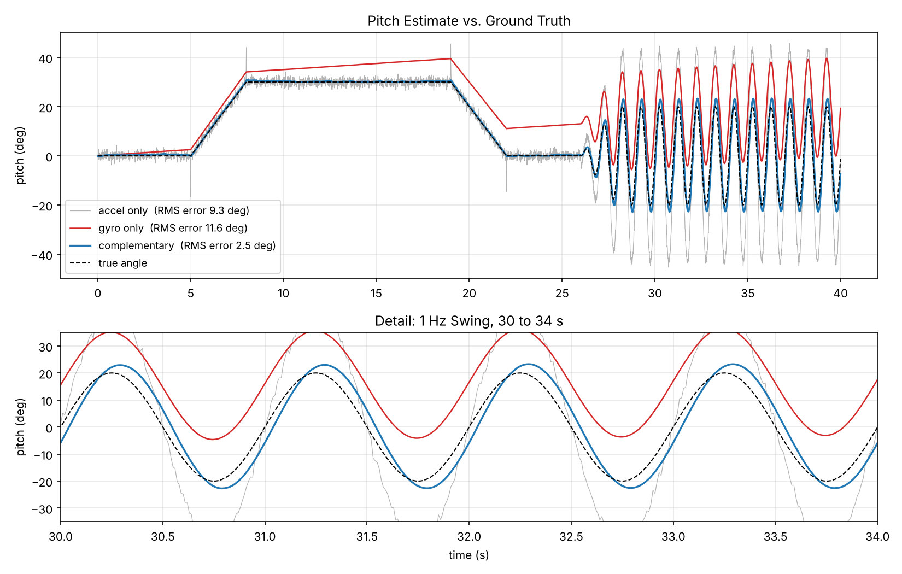

# ESP32 IMU Logger


ESP32 firmware that reads an MPU6050 IMU at 100 Hz over I2C, estimates roll and pitch with a complementary filter, and streams CSV over serial. A Python host plots and logs the stream in real time. Runs in the Wokwi simulator or on a physical board with no code changes.



## Sensor Fusion Results

Synthetic data with known ground truth: sensor 30 cm from a pivot; stationary, 30° tilt and return, then a 1 Hz ±20° swing. The gyro has 0.5 °/s residual bias plus white noise. The accelerometer has white noise plus tangential acceleration during the swing.

| Estimate | RMS Error (deg) |
|---|---|
| Gyro only (integrated rate) | 11.6 |
| Accelerometer only (gravity angle) | 9.3 |
| Complementary filter | 2.5 |

```
angle = α · (angle + gyro_rate · dt) + (1 − α) · accel_angle,     α = τ / (τ + dt)
```

τ = 0.5 s and dt = 10 ms give α = 0.980. A constant gyro bias b produces a bounded steady error of τ·b, compared with unbounded drift for pure integration (verified in both test suites).

Regenerate with `python -m host.analyze --simulate`.

## Architecture

```
MPU6050 --I2C 400 kHz--> ESP32 --UART 115200, CSV--> host/live_plot.py --> plot + logs/*.csv
                         100 Hz fixed-rate loop       serial port, or Wokwi via rfc2217://localhost:4000
                         gyro bias calibration
                         complementary filter
```

## Running

### Wokwi (Browser)

1. Create a new ESP32 project at wokwi.com.
2. Replace `sketch.ino` with `src/main.cpp`.
3. Add a file named `imu_filter.h` containing `include/imu_filter.h`.
4. Replace `diagram.json` with the one in this repo.
5. Start the simulation. CSV lines begin after the 2 s gyro calibration. Adjust the MPU6050 sliders to change the inputs.

### Wokwi (VS Code) with Live Plot

1. Install the PlatformIO IDE and Wokwi Simulator extensions; request a free Wokwi license from the command palette.
2. `pio run`
3. Run "Wokwi: Start Simulator" and keep the simulator tab visible.
4. `python -m host.live_plot --port rfc2217://localhost:4000`

`wokwi.toml` exposes the simulated UART as an RFC2217 server on port 4000, which PySerial opens like a physical port.

### Hardware

| MPU6050 | ESP32 |
|---|---|
| VCC | 3V3 |
| GND | GND |
| SDA | GPIO 21 |
| SCL | GPIO 22 |

`pio run -t upload`, then `python -m host.live_plot --port /dev/ttyUSB0` (`COM3` on Windows).

### Synthetic Demo

`python -m host.live_plot --demo` runs the same parser, plotter, and logger on simulated data.

## Firmware Notes

- **Register-level I2C (no sensor library):** checks WHO_AM_I at boot, sets ±2 g and ±250 °/s ranges, and reads all 14 data bytes in one burst so all axes share a sample instant.
- **Fixed-rate loop** scheduled on `micros()` rather than `delay()`, so the period does not depend on execution time. Signed comparison handles counter wraparound.
- **Gyro bias calibration:** mean of 200 stationary samples at startup.
- **Buffered reads:** bytes are read into an array before combining, since the evaluation order of two `Wire.read()` calls in one expression is unspecified.
- **Portable filter header:** `include/imu_filter.h` has no Arduino dependencies and is compiled both for the ESP32 and for host unit tests.

Build size: 22% of flash, 7% of RAM.

## Serial Format

Lines beginning with `#` are status messages. Each sample (100 Hz):

```
t_ms,ax_g,ay_g,az_g,gx_dps,gy_dps,gz_dps,roll_deg,pitch_deg
```

## Tests

CI runs three jobs:

- **Python (pytest):** CSV parsing and corrupt-line rejection, accelerometer angles, τ·b bias bound, fused error below half of the best single sensor
- **Firmware math (g++):** big-endian byte assembly including negative values, filter coefficient, initialization, bias bound, rotation tracking
- **Firmware build (PlatformIO):** compiles the ESP32 firmware

## Project Structure

```
src/main.cpp                ESP32 firmware
include/imu_filter.h        filter math shared by firmware and host tests
diagram.json, wokwi.toml    Wokwi circuit and simulator config
platformio.ini              firmware build config
host/
  stream.py                 serial, Wokwi, and synthetic sources; CSV parser
  imu_math.py               Python port of the filter; synthetic IMU data
  live_plot.py              real-time plot and CSV logging
  analyze.py                plot recorded logs; regenerate the figure
tests/                      Python tests (tests/firmware/: C++ tests)
```

## License

MIT
