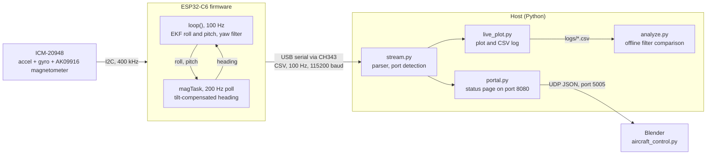
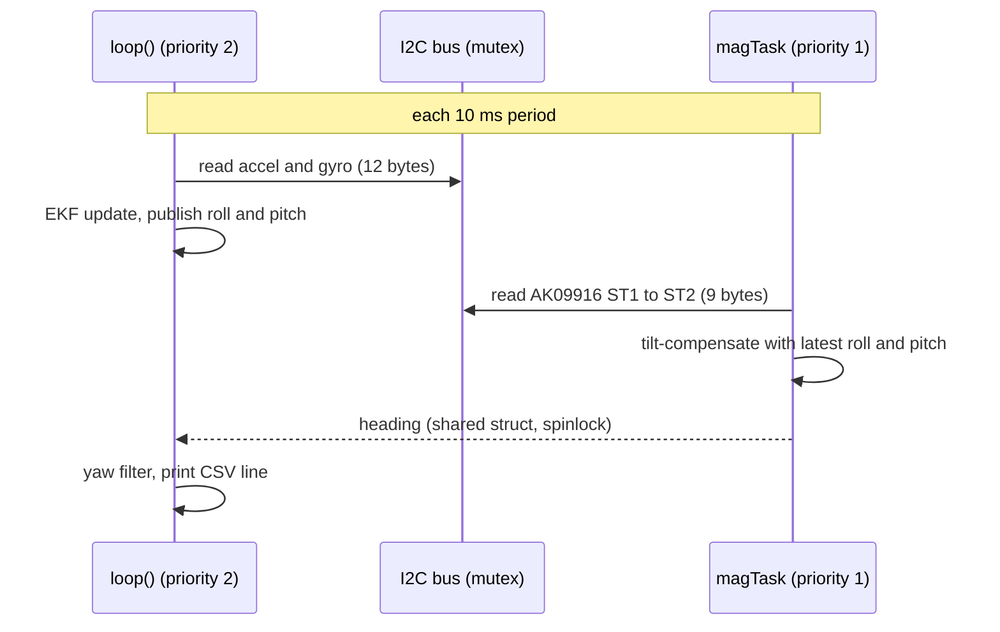

# ESP32 IMU Logger


Real-time roll, pitch and heading from an ESP32-C6 and an ICM-20948 9-axis IMU, streamed to a Python plotter and used to fly a jet in Blender.

I started this to compare a complementary filter against an extended Kalman filter (EKF) on real IMU data, then grew it into a full attitude and heading reference: register-level sensor drivers (no libraries), an EKF that learns gyro bias, tilt-compensated magnetometer heading, and a Blender scene you fly by tilting the board. On a simulated benchmark the EKF gets **0.25° RMS** tilt error, against 2.55° for the complementary filter and 9.3° for the accelerometer alone.

**Contents:** [How it works](#how-it-works) · [Hardware](#hardware) · [Firmware](#firmware) · [Host software](#host-software) · [Blender](#blender) · [Results and testing](#results-and-testing) · [Limitations and next steps](#limitations-and-next-steps) · [Appendices](#appendix-a-setup-guide)

## How it works

No single motion sensor gives you orientation on its own:

- **Gyroscope:** smooth, but integrating its rate drifts forever, since any bias keeps adding up.
- **Accelerometer:** knows which way is down, so roll and pitch don't drift, but it's noisy and can't tell gravity from a moving hand.
- **Magnetometer:** gives heading, but only once you correct for tilt, and nearby metal throws it off.

Fusing them lets each cover the others' weak spots.



| Stage | Component | Role |
|---|---|---|
| Sensing | ICM-20948 | Accelerometer and gyroscope at 225 Hz output rate; AK09916 magnetometer at 100 Hz |
| Estimation | ESP32-C6 firmware (`src/main.cpp`, `include/imu_filter.h`) | Calibration, EKF tilt, tilt-compensated heading, yaw fusion, CSV output |
| Transport | USB serial (CH343 chip) | 10 CSV columns per sample at 100 Hz |
| Host | `host/` (Python) | Port detection, parsing, live plot, logging, offline analysis, UDP bridge |
| Visualization | `blender/aircraft_control.py` | Procedural jet whose attitude and position follow the board |

## Hardware

| Part | Notes |
|---|---|
| ESP32-C6 DevKit with CH343 USB serial | One RISC-V core, two USB-C ports (CH343 and native USB). An original ESP32 DevKit also works (Appendix B). |
| ICM-20948 breakout board | Any 3.3 V I2C breakout (for example Adafruit 4554 or SparkFun 15335). The AK09916 magnetometer is inside the same package. |
| 4 jumper wires, or a Qwiic / STEMMA QT cable | 3V3, GND, SDA, SCL |
| USB-C data cable | Some cables only charge |

### Wiring


| ICM-20948 board | ESP32-C6 DevKit | Original ESP32 DevKit |
|---|---|---|
| VCC (or VIN / 3.3V) | 3V3 | 3V3 |
| GND | GND | GND |
| SDA | GPIO 21 | GPIO 21 |
| SCL | GPIO 22 | GPIO 22 |
| AD0, INT, FSYNC | not connected | not connected |

Pin order varies between ICM-20948 boards, so go by the printed labels. Most breakouts already have I2C pull-ups; if yours doesn't, add 4.7 kΩ from SDA and SCL to 3V3. The diagram comes from `tools/wiring_diagram.py`.

Use the USB-C port marked **CH343**. That's where the firmware prints (UART0 through the CH343 chip); the other port is the C6's native USB.

**Why these pins:**

| Pins | Why they are avoided or used |
|---|---|
| GPIO 21, 22 | Used for I2C: plain GPIOs with no boot or USB function. The same numbers exist on the original ESP32 DevKit, so the wiring is identical on both boards. |
| GPIO 4, 5, 8, 9, 15 | Boot strapping pins: their level at reset selects the boot mode. GPIO 9 is the BOOT button and GPIO 8 drives the RGB LED. |
| GPIO 12, 13 | Native USB D− and D+ |
| TX, RX (GPIO 16, 17) | UART0 link to the CH343, used for the CSV stream |

**Axes.** The accel and gyro use **+x forward, +y left, +z up**. The magnetometer die inside the chip has y and z flipped, so the firmware converts it before using it. Mount the board flat and away from motors, batteries, steel and magnets.

## Firmware

### Two tasks on one core

The C6 has a single main core, so the work is split into two FreeRTOS tasks that take turns:

| Task | Priority | Rate | Work |
|---|---|---|---|
| `loop()` (Arduino loopTask) | 2 | 100 Hz | Read accelerometer and gyro, run the EKF, fuse yaw, print one CSV line. The only task that writes to Serial. |
| `magTask` | 1 | polls at 200 Hz | Read each new 100 Hz AK09916 sample, tilt-compensate it with the latest roll and pitch, publish a heading |



- Both tasks wake with `vTaskDelayUntil`, so the 10 ms period stays exact and they sleep in between. A busy-wait on a single core would starve the other task.
- `loop()` has the higher priority, so IMU timing never slips.
- Both sensors share one I2C bus behind a mutex. Priority inheritance means a magnetometer read in progress (about 0.3 ms) finishes right away when `loop()` needs the bus.
- The tasks only swap roll, pitch and the latest heading, through a small spinlock-guarded struct. A sequence number tells `loop()` whether a heading is new.
- On the dual-core ESP32 the same code runs the two tasks on separate cores, truly in parallel.

### ICM-20948 setup

Everything is register level. I checked the register map against the datasheet values in SparkFun's driver and in PX4. Registers live in four banks selected by `REG_BANK_SEL` (0x7F, bits 5:4).

| Step | Register | Value | Effect |
|---|---|---|---|
| Probe | WHO_AM_I (bank 0, 0x00) | expect 0xEA | Tried at 0x69 (AD0 high, most boards), then 0x68 |
| Reset | PWR_MGMT_1 (0x06) | 0x80, wait 100 ms | All registers to defaults |
| Wake | PWR_MGMT_1 | 0x01 | Out of sleep, best available clock (gyro PLL) |
| Enable axes | PWR_MGMT_2 (0x07) | 0x00 | All accelerometer and gyro axes on |
| Aux bus | USER_CTRL (0x03) | 0x00 | Internal I2C master off |
| Bypass | INT_PIN_CFG (0x0F) | 0x02 | AK09916 appears directly on the host bus at 0x0C |
| Gyro rate | GYRO_SMPLRT_DIV (bank 2, 0x00) | 4 | 1125 / (1 + 4) = 225 Hz output |
| Gyro range and filter | GYRO_CONFIG_1 (bank 2, 0x01) | 0x19 | ±250 °/s (131 LSB per °/s), low-pass about 50 Hz |
| Accel rate | ACCEL_SMPLRT_DIV_1, _2 (bank 2, 0x10, 0x11) | 0, 4 | 225 Hz output |
| Accel range and filter | ACCEL_CONFIG (bank 2, 0x14) | 0x19 | ±2 g (16384 LSB per g), low-pass about 50 Hz |
| Magnetometer | AK09916 WIA2 (0x01), CNTL3 (0x32), CNTL2 (0x31) | expect 0x09; 0x01; 0x08 | Check ID, soft reset, continuous mode at 100 Hz |

225 Hz output with a ~50 Hz low-pass means sampling at 100 Hz doesn't alias. Each IMU sample is one 12-byte burst so all six axes come from the same instant. Each magnetometer read is one 9-byte burst from ST1 to ST2; ST1 says a sample is ready, ST2 flags overflow, and reading ST2 releases the sample.

### Calibration at startup

1. **Hold still for 2 s.** The average gyro reading is its bias, subtracted from then on. The EKF learns whatever's left.
2. **Rotate in every direction for 15 s.** Magnets and magnetized parts on the board shift every magnetometer reading by a constant. The midpoint of each axis's min and max is that offset (hard-iron calibration).
3. CSV output starts. Status lines start with `#`.

### Roll and pitch

Both filters live in `include/imu_filter.h`; `FUSION_EKF` picks one at compile time and the CSV is the same either way.

**Complementary filter (the baseline):**

```
angle = α · (angle + gyro_rate · dt) + (1 − α) · accel_angle,     α = τ / (τ + dt)
```

With τ = 0.5 s and dt = 10 ms, α = 0.980: fast motion comes from the gyro, slow drift is corrected by the accelerometer. A constant gyro bias b leaves a fixed error of τ·b instead of unbounded drift.

**Extended Kalman filter (the default):** state `x = [roll, pitch, b_x, b_y]`, the two angles plus gyro bias on each tilt axis.

- **Predict:** full Euler-angle kinematics from the bias-corrected gyro, `roll' = p + sin(roll)·tan(pitch)·q + cos(roll)·tan(pitch)·r` and `pitch' = cos(roll)·q − sin(roll)·r`, linearized analytically for the covariance.
- **Update:** the accelerometer measures gravity in the body frame, `h(x) = [−sin(pitch), sin(roll)·cos(pitch), cos(roll)·cos(pitch)]`.
- **Adaptive noise:** `R = σ²_a + k·(|a| − 1 g)²`, so it trusts the accelerometer less while the board is accelerating. That removes the complementary filter's lag and overshoot during fast moves.
- **Tuning:** gyro noise 0.3 °/s, bias random walk 0.01 °/s, accelerometer noise 0.05 g, k = 10.

The EKF learns the leftover bias (0.52 °/s estimated vs 0.50 °/s true), needs no small-angle approximation, and ignores linear acceleration. The same filter exists in C++ for the ESP32 and in NumPy (`host/imu_math.py`); both hit 0.25° RMS on the benchmark.

### Heading

1. **Axis fix:** convert the magnetometer reading to the accel frame by flipping y and z (`imu::ak09916ToImuFrame`), then remove the hard-iron offset.
2. **Tilt compensation:** a compass only works level, so project the field onto the horizontal plane using roll φ and pitch θ:

```
x_h = m_x·cos θ + m_y·sin φ·sin θ + m_z·cos φ·sin θ
y_h = m_y·cos φ − m_z·sin φ
ψ_mag = atan2(−y_h, x_h)
```

3. **Blend with the gyro:** the magnetometer is absolute but noisy near metal; the gyro is smooth but drifts. A complementary yaw filter combines them, wrapping angles the short way round so crossing ±180° doesn't spin it:

```
yaw ← wrap(yaw + g_z·dt)                          every sample
yaw ← wrap(yaw + (1 − α)·wrap(ψ_mag − yaw))       when a new heading has arrived
α = τ / (τ + dt),  τ = 10 s
```

The 10 s time constant means a brief magnetic disturbance barely moves the heading. Yaw reads `nan` until the first magnetometer sample.

**Convention:** yaw is 0 when +x points at magnetic north and increases **counterclockwise** seen from above. Set `HEADING_SIGN = -1` for a clockwise compass heading. No declination correction, so it's magnetic north, not true north.

### Build size (with the EKF)

| Target | Flash | RAM |
|---|---|---|
| ESP32-C6 (`esp32c6`) | 24.8% | 4.7% |
| Original ESP32 (`esp32dev`) | 26.4% | 7.2% |
| Wokwi simulation (`wokwi`) | 26.2% | 7.2% |

## Host software

Python 3.9+, in `host/`:

| Module | Purpose |
|---|---|
| `stream.py` | Serial, Wokwi (RFC2217) and synthetic sources; CSV parser; serial port auto-detection |
| `live_plot.py` | Real-time plot of accelerometer, gyro, roll and pitch, and heading; writes each session to `logs/` |
| `analyze.py` | Plots recorded logs (with a heading panel when the log has yaw), regenerates the benchmark figure, and reruns both filters offline on a real log |
| `imu_math.py` | NumPy versions of both filters and the synthetic IMU generator |
| `portal.py` | Bridge to Blender over UDP, with a live status page |

- The parser skips `#` lines and corrupted lines. Old 9-column logs (from before the magnetometer) still load, with yaw as `nan`.
- Port auto-detect knows the common USB-serial chips (CP210x, CH340, CH343, CH9102, FTDI). With both C6 USB ports plugged in, it picks the CH343.
- `python -m host.portal --port auto` sends each sample to Blender as UDP JSON on 127.0.0.1:5005, like `{"roll": 12.3, "pitch": -4.5, "yaw": 87.0, "t_ms": 12345}`, and shows live values at http://127.0.0.1:8080. `--demo` uses fake data; `--reset` re-centres the jet.

## Blender

`blender/aircraft_control.py` runs in Blender's Text Editor. If there's no object called `Aircraft`, it builds a simple jet out of primitives, so there's no model to download or license.

About 60 times a second it reads the newest packet, smooths it, and:

- **Rotates the jet:** `R = Rz(yaw) · Rx(pitch) · Ry(roll)`, so roll and pitch are about the jet's own axes and heading is about world vertical. Building it from matrices avoids Euler-angle axis-order bugs.
- **Moves the jet:** tilt past 3° and it slides sideways (roll) or climbs and dives (pitch) at 0.6 m/s per degree past the deadband. Hold the board level and it stays put.

`ROLL_SIGN`, `PITCH_SIGN` and `YAW_SIGN` flip directions if it moves the wrong way.

**To run it:** open the script in Blender's Text Editor and hit Run Script, then start `python -m host.portal --port auto` (or `--demo`).

## Results and testing

### Simulation benchmark


Simulated sensor 30 cm from a pivot: still, a 30° tilt and back, then a 1 Hz ±20° swing. The gyro has 0.5 °/s bias plus noise; the accelerometer has noise plus the swing's tangential acceleration.

| Estimate | RMS Error (deg) |
|---|---|
| Gyro only (integrated rate) | 11.6 |
| Accelerometer only (gravity angle) | 9.3 |
| Complementary filter | 2.55 |
| **Extended Kalman filter** | **0.25** |

Rebuild it with `python -m host.analyze --simulate`.

### Testing on real hardware

1. Record a session (menu option 2, or `python -m host.live_plot --port auto`). Hold still for the 2 s calibration, then rotate for the 15 s magnetometer calibration.
2. Hold the board at known pitch angles for 3 s or more each, in order (for example 0°, 30°, 45°, 60° against a protractor or a printed wedge).
3. Run `python -m host.analyze --compare logs/imu_YYYYMMDD_HHMMSS.csv --holds 0,30,45,60`.

This reruns both filters on the logged raw data, matches each still segment to a hold angle, and prints and plots the error for each filter (saved as `_compare.png` next to the log).

**Heading check:** lay the board flat with +x toward magnetic north (use a phone compass) and `yaw_deg` should read about 0. Turn it 90° counterclockwise and it should read about +90.

### Automated tests

| Suite | What it checks |
|---|---|
| Python (pytest, `tests/`) | CSV parsing (10 columns, 9-column legacy logs, `nan` yaw, corrupt lines); log plots with and without heading; port detection on Windows, macOS and Linux, including CH343 over native USB; accelerometer angles; the τ·b bias bound; fused error below half of the best single sensor; EKF error below a quarter of the complementary filter's; EKF bias learning at 0, 0.5 and 2 °/s; combined roll and pitch; still-segment detection and hold scoring; portal packets and state; Blender stick mapping, packet parsing, attitude matrix, jet construction, and flight and yaw from live UDP packets (these need `bpy` and are skipped without it) |
| Firmware math (C++, `tests/firmware/`) | Compiled from the same `imu_filter.h` the ESP32 uses: big-endian byte assembly, complementary filter, EKF initialization, bias learning and rotation tracking, angle wrapping, heading on level and tilted boards, heading sign, AK09916 axis mapping, and the yaw filter (initialization, tracking, bias bound, gyro-only drift, ±180° crossing) |
| Firmware build (PlatformIO) | Compiles all three targets: `esp32c6`, `esp32dev`, `wokwi` |

GitHub Actions runs all of this on every push: Python tests on Ubuntu 24.04, macOS and Windows (Python 3.9 and 3.13), the C++ tests on Ubuntu and macOS, and every firmware build. Ubuntu is pinned to 24.04 because newer images don't have Python 3.9.

## Limitations and next steps

**Known limits:**

- **Not yet run on real hardware.** The ICM-20948 firmware compiles for every target and the math is unit-tested, but I haven't flashed it to a board yet.
- **Gimbal lock:** the EKF uses tan(pitch), so it degrades near ±90° pitch.
- **Magnetometer calibration** handles hard-iron offsets only, not soft-iron distortion, and there's no declination correction.
- **Yaw gyro bias** isn't learned (the EKF only tracks x and y), so a leftover z bias b_z causes a steady heading offset of about 10 s × b_z.
- **Wokwi** has no ICM-20948, so the simulator build uses an MPU6050 and has no heading.

**Next steps:**

1. Replace both filters with one quaternion EKF that uses the magnetometer directly and learns all three gyro biases. That removes gimbal lock and the separate yaw filter.
2. Ellipsoid-fit soft-iron calibration, saved to flash so the 15 s rotation only happens once.
3. Validate against a reference (motion capture or a rotary stage) and report heading accuracy.
4. Stream over the C6's Wi-Fi or Bluetooth LE to drop the USB cable.

## Appendix A: Setup Guide

For Mac or Windows, no experience needed.

You do not need to know Python. Each step says exactly what to click or type; copying and pasting is fine.

**1. Install Python (once per computer)**

- **Mac:** open Terminal (press Cmd+Space, type `Terminal`, press Return). Type `python3 --version` and press Return.
  - If it shows Python 3.9 or newer, go to step 2.
  - If a box offers to install the "command line developer tools", click **Install**, wait for it to finish, and check again.
  - Otherwise download the macOS installer from https://www.python.org/downloads/, open it, and click through.
- **Windows:** download the installer from https://www.python.org/downloads/ and open it. On the first screen tick **Add python.exe to PATH**, then click **Install Now**.

**2. Download this project**

Click the green **Code** button at the top of this page, then **Download ZIP**. Unzip it: on a Mac double-click the ZIP in Downloads; on Windows right-click it, choose **Extract All**, then **Extract**. You now have a folder named `ESP32-IMU-Logger-main`.

**3. Start it**

- **Windows:** open the `ESP32-IMU-Logger-main` folder and double-click **start.bat**.
- **Mac:** in Terminal type `cd ` (with a space after it), drag the `ESP32-IMU-Logger-main` folder from Finder into the Terminal window, and press Return. Then type `python3 start.py` and press Return.

The first time, it sets itself up: it creates a private Python environment inside the project folder and downloads the libraries it needs. This takes a few minutes and needs internet. Then a menu appears. Type a number and press Enter:

| Option | What it does | What you get |
| --- | --- | --- |
| 1 | Live plot with simulated data | No hardware needed. Shows accelerometer, gyro, fused tilt and heading scrolling live and saves a log in `logs/` (the simulated data has no magnetometer, so the heading panel stays empty). Close the plot window to stop |
| 2 | Live plot from a real ESP32 | With the board plugged in by USB and running the firmware (see Appendix B). Finds the port automatically |
| 3 | Live plot from the Wokwi simulator | With the simulator running in VS Code (see Appendix B) |
| 4 | List the serial ports | Shows every serial port and which one looks like the ESP32 |
| 5 | Plot a recorded log | Plots a CSV from `logs/` (the newest by default) |
| 6 | Regenerate the filter comparison figure | Rebuilds `figures/filter_comparison.png` and opens it |
| 7 | Run the automated tests | Checks parsing, the filter math and port detection |

To use it again later, repeat step 3; setup is skipped and the menu appears in a few seconds. Type `q` and press Enter to quit.

**Troubleshooting (computer and Python)**

| Problem | Fix |
| --- | --- |
| Mac: `command not found: python3` | Install Python (step 1). |
| Windows: `Python was not found`, or the Microsoft Store opens | Install Python from python.org (step 1) and tick **Add python.exe to PATH**. If you already installed it without that box, run the installer again, choose **Modify**, then **Next**, and tick **Add Python to environment variables**. |
| Windows: "Windows protected your PC" when opening start.bat | Click **More info**, then **Run anyway**. The file only runs `py start.py`; you can open it in Notepad to check. |
| `This project needs Python 3.9 or newer` | Install the current Python from https://www.python.org/downloads/ |
| `Could not tell which port is the ESP32` | Use a USB **data** cable (some only charge). Install the USB driver for the chip printed next to the board's USB port: CP2102 or CP2104 uses the [Silicon Labs CP210x driver](https://www.silabs.com/developers/usb-to-uart-bridge-vcp-drivers); CH340 or CH9102 uses the CH340 driver ([install guide](https://learn.sparkfun.com/tutorials/how-to-install-ch340-drivers/all)). CH343 (the ESP32-C6 DevKit) often works without installing anything; if it does not appear, install the CH343 driver from its maker, WCH. On a Mac, allow the driver under System Settings, Privacy and Security. Then pick option 4 to check. |
| `Could not open` the port | Another program is using it. Close the Arduino IDE or PlatformIO serial monitor and try again. |
| The plot window is blank | No data is arriving yet: data starts only after calibration (2 s holding the board still, then 15 s rotating it). Check also that the firmware is running and the baud rate is 115200. |
| `Installing libraries failed` or setup stops with an error | Check your internet connection, delete the `.venv` folder inside the project folder, and start again. (On a Mac the folder is hidden: press Cmd+Shift+. in Finder to show it.) |
| A figure did not open by itself | Look in the project's `figures` folder. |

**For developers.** `start.py` only creates `.venv`, installs `requirements.txt` and runs the commands below, so you can also work by hand (Python 3.9 or newer):

```bash
# macOS / Linux
python3 -m venv .venv
source .venv/bin/activate
pip install -r requirements.txt
```

```powershell
# Windows (PowerShell or Command Prompt)
py -m venv .venv
.venv\Scripts\activate       # if PowerShell blocks this: Set-ExecutionPolicy -Scope CurrentUser RemoteSigned
pip install -r requirements.txt
```

```bash
python -m host.live_plot --demo              # simulated data
python -m host.live_plot --port auto         # real board (or --port COM3, --port /dev/cu.usbserial-0001)
python -m host.live_plot --list-ports
python -m pytest
```

`python start.py <shortcut>` runs one menu option directly (`python start.py --list` shows the shortcuts). CI runs the tests through `start.py` on macOS, Windows and Linux with Python 3.9 and 3.13.

## Appendix B: Building, Flashing and Simulating

The menu options in Appendix A need only Python. Running the firmware itself needs VS Code with the PlatformIO IDE extension, or a browser (Wokwi).

**Build targets** (`platformio.ini`; `pio run` builds all three):

| Target | Board | IMU | Command |
|---|---|---|---|
| `esp32c6` | ESP32-C6 DevKit | ICM-20948 | `pio run -e esp32c6 -t upload` |
| `esp32dev` | Original ESP32 DevKit | ICM-20948 | `pio run -e esp32dev -t upload` |
| `wokwi` | Simulated original ESP32 | MPU6050 (no magnetometer) | `pio run -e wokwi` |

**Real board.** Wire it as shown in [Wiring](#wiring), connect the CH343 USB-C port, run the upload command, then menu option 2 (or `python -m host.live_plot --port auto`). Port names look like `COM3` on Windows, `/dev/cu.usbserial-0001`, `/dev/cu.wchusbserial...` or `/dev/cu.usbmodem...` on macOS (use the `cu.` one), and `/dev/ttyUSB0` or `/dev/ttyACM0` on Linux. If the upload does not start, hold BOOT, tap RST, release BOOT, and upload again.

**Status messages at startup**

| Message | Meaning and fix |
|---|---|
| `# ICM-20948 found at I2C address 0x69` | Normal (0x68 if AD0 is tied low) |
| `# ERROR: ICM-20948 not found on I2C (SDA GPIO 21, SCL GPIO 22)` | Check VCC, GND, SDA and SCL, and that SDA and SCL are not swapped |
| `# gyro bias (deg/s): ...` | Normal; keep the board still until it appears |
| `# magnetometer: rotate the board slowly in every direction for 15 s` | Start rotating now |
| `# mag offset (counts): ... from N samples` | Normal; N should be about 1500 |
| `# WARN: AK09916 magnetometer not found (bypass mode)` | Yaw will be `nan`. Usually a board that is not a genuine ICM-20948 |
| `# WARN: N magnetometer read failures in the last second` | Bus errors, or a magnet near the sensor overflowing its range |

**Wokwi in the browser**

1. Create a new ESP32 project at wokwi.com.
2. Replace `sketch.ino` with `src/main.cpp`, and add `#define IMU_MPU6050` as its first line (the browser cannot pass build flags).
3. Add a file named `imu_filter.h` containing `include/imu_filter.h`.
4. Replace `diagram.json` with the one in this repository (an MPU6050 on GPIO 21 and 22).
5. Start the simulation. CSV lines begin after the 2 s gyro calibration. Move the MPU6050 sliders to change the inputs. Yaw is `nan`, since the simulated sensor has no magnetometer.

**Wokwi in VS Code, with the live plot**

1. Install the PlatformIO IDE and Wokwi Simulator extensions, and request a free Wokwi license from the command palette.
2. `pio run -e wokwi`
3. Run "Wokwi: Start Simulator" and keep the simulator tab visible.
4. Menu option 3 (or `python -m host.live_plot --port rfc2217://localhost:4000`). `wokwi.toml` exposes the simulated UART as an RFC2217 server on port 4000, which PySerial opens like a physical port.

**Synthetic demo.** Menu option 1 (or `python -m host.live_plot --demo`) runs the same parser, plotter and logger on simulated data, with no board.

## Appendix C: Serial Protocol

115200 baud, 8N1. Lines beginning with `#` are status messages. Each sample, at 100 Hz:

```
t_ms,ax_g,ay_g,az_g,gx_dps,gy_dps,gz_dps,roll_deg,pitch_deg,yaw_deg
```

| Column | Unit | Description |
|---|---|---|
| `t_ms` | ms | Time since boot |
| `ax_g`, `ay_g`, `az_g` | g | Accelerometer |
| `gx_dps`, `gy_dps`, `gz_dps` | °/s | Gyroscope, startup bias removed |
| `roll_deg`, `pitch_deg` | ° | Attitude filter output |
| `yaw_deg` | ° | Fused heading in [−180, 180); `nan` until the first magnetometer sample, or always on the `wokwi` target |

## Appendix D: Configuration Constants

At the top of `src/main.cpp`:

| Constant | Default | Meaning |
|---|---|---|
| `SDA_PIN`, `SCL_PIN` | 21, 22 | I2C pins |
| `I2C_HZ` | 400000 | I2C clock |
| `SAMPLE_HZ` | 100 | Accelerometer, gyro and CSV rate |
| `MAG_TASK_HZ` | 200 | Magnetometer polling rate (sensor outputs 100 Hz) |
| `FUSION_EKF` | 1 | 1: EKF, 0: complementary filter |
| `FILTER_TAU_S` | 0.5 | Complementary filter time constant (s) |
| `YAW_TAU_S` | 10 | Yaw filter time constant (s) |
| `HEADING_SIGN` | 1 | 1: counterclockwise-positive yaw; −1: clockwise compass heading |
| `CALIBRATION_SAMPLES` | 200 | Gyro calibration length (2 s) |
| `MAG_CAL_SAMPLES` | 1500 | Magnetometer calibration length (15 s) |

At the top of `blender/aircraft_control.py`: `ROLL_SIGN`, `PITCH_SIGN`, `YAW_SIGN`, `SMOOTHING`, `DEADBAND_DEG`, `SPEED_PER_DEG`, `UDP_PORT`.

## Appendix E: Project Structure

```
start.py, start.bat         beginner launcher: sets up .venv and shows the menu
src/main.cpp                ESP32 firmware (ICM-20948 driver, tasks, CSV output)
include/imu_filter.h        filter math shared by the firmware and the C++ tests
platformio.ini              build targets: esp32c6, esp32dev, wokwi
diagram.json, wokwi.toml    Wokwi circuit (MPU6050) and simulator config
figures/                    wiring diagram and filter comparison figure
tools/wiring_diagram.py     generates figures/wiring_diagram.svg
host/
  stream.py                 serial, Wokwi and synthetic sources; CSV parser; port detection
  imu_math.py               Python versions of both filters; synthetic IMU data
  live_plot.py              real-time plot and CSV logging
  analyze.py                plot logs; regenerate the figure; EKF vs. complementary on real logs
  portal.py                 ESP32 to Blender UDP bridge with a live status page
blender/
  aircraft_control.py       Blender script: procedural jet, tilt-driven attitude and position
tests/                      Python tests (tests/firmware/: C++ tests)
```

## License

MIT
